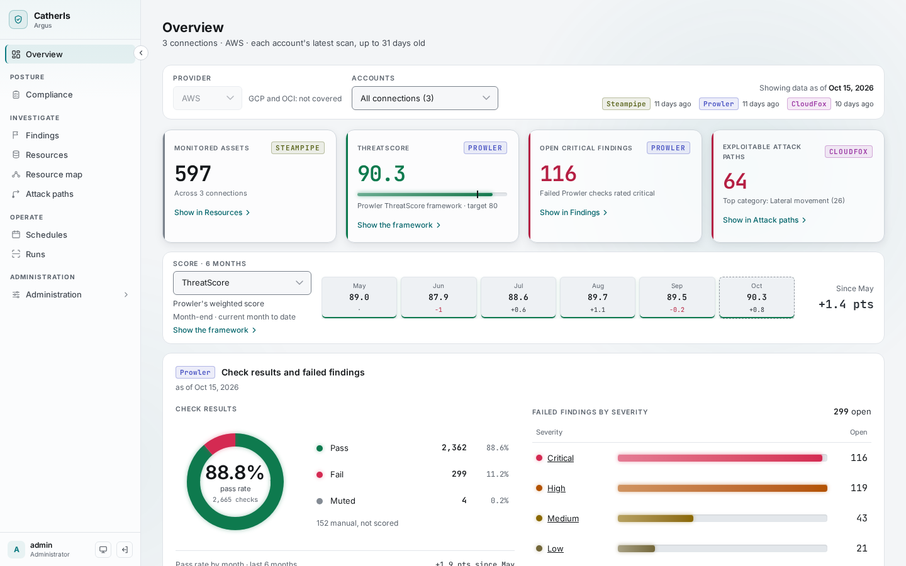
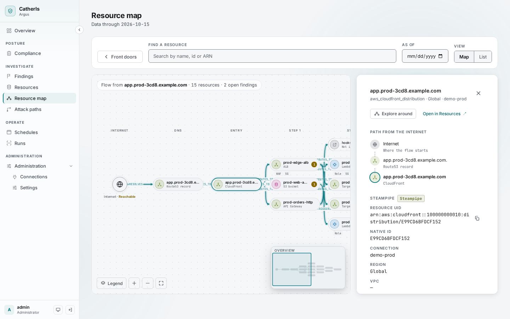
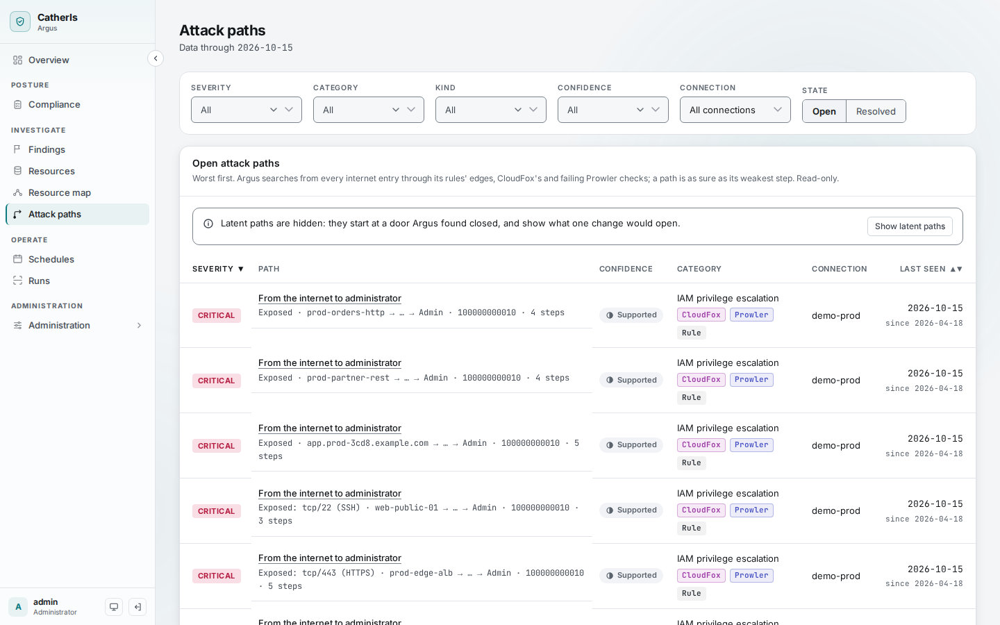
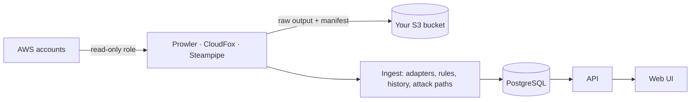

# CatherIs Argus

A self-hosted cloud security platform. Argus runs three open-source scanners,
[Prowler](https://github.com/prowler-cloud/prowler),
[CloudFox](https://github.com/BishopFox/cloudfox) and
[Steampipe](https://github.com/turbot/steampipe-plugin-aws), unmodified. It owns what they lack:
the join between their results, the history, and one UI to read them. Argus only reads the
clouds it scans; it never changes anything in them.



## Why the join matters

Each tool answers one question. Prowler says which checks fail. CloudFox says what an attacker can
reach from a foothold. Steampipe says what exists and how it is configured. The findings that
matter most need all three. For example: a resource reachable from the internet (CloudFox),
with a failing high-severity check (Prowler), whose role can escalate to administrator (CloudFox
again), on a configuration Steampipe recorded yesterday. Argus keys every result on the cloud's
own resource id, so the three tools land on the same resource, every day.

## What it does

| | |
| --- | --- |
| **Compliance** | Every framework Prowler maps, with Prowler's ThreatScore, per account and month over month |
| **Findings** | Failing checks with what each tool found on the resource, their history (new, resolved, reopened) and remediation, as a list or grouped by check |
| **Resources** | The inventory Steampipe collects, with each resource's configuration on any past day, and AWS Inspector's vulnerabilities on instances, functions and container repositories |
| **Resource map** | How resources connect: from the internet through DNS, load balancers and gateways to compute, roles and data |
| **Attack paths** | Paths from an internet entry, an outside principal or a leaked key to administrator or data, each step with its evidence and fix |
| **Operations** | Schedules, run history, and connections added in the UI; every change audited |

| Resource map | Attack paths |
| --- | --- |
|  |  |

## How it works



Data moves one way. The tools run on a schedule and write raw output to your own S3 bucket.
Ingest turns it into one model keyed on the cloud's resource ids, derives the connections between
resources with versioned rules, and stores a daily snapshot, so any past day can be read again.
The design, and the reasoning behind each decision, is in [docs/design.md](docs/design.md) and the
[architecture decision records](docs/adr/README.md).

## Status

**Alpha, pre-1.0.** Argus scans real AWS accounts and has a complete UI, but it is young:

- users with three roles (Viewer, Operator, Admin) and local passwords; no single sign-on yet
- AWS only; GCP and OCI are planned
- no built-in Postgres backups
- the Helm chart is verified on a local kind cluster, not yet on EKS

## Quick start

Try it on your machine with three Demo connections and six months of synthetic history; no cloud
account needed. You need Docker with Compose v2, and nothing else: every command runs in a
container.

```bash
cp .env.example .env
docker compose run --rm admin-tools hash-password    # the first admin: paste the printed line into .env
docker compose run --rm admin-tools new-secret-key   # paste both printed lines into .env
docker compose up -d --build
docker compose run --rm seed --days 180
```

Open <http://localhost:8080> and sign in as `admin`. [Getting started](docs/getting-started.md)
walks through what each screen shows.

## Deploy

- **One host with Docker Compose:** [docs/runbook.md](docs/runbook.md)
- **Kubernetes with the Helm chart** (`charts/argus/`): [docs/runbook-kubernetes.md](docs/runbook-kubernetes.md)
- **Connecting your AWS accounts:** [docs/connect-aws.md](docs/connect-aws.md)
- **Configuration reference:** [docs/configuration.md](docs/configuration.md)

## Security

Argus holds a map of how to attack the clouds it scans, so it is built to be as hard to
compromise as they are. It is read-only toward every cloud; credentials are encrypted and never
shown again; it keeps no secret value it finds in its database, and raw tool output goes only to
your own bucket. Read the [security model](docs/security-model.md).
To report a vulnerability, see [SECURITY.md](SECURITY.md).

## Documentation

Everything is indexed in [docs/README.md](docs/README.md).

## Contributing

Contributions are welcome. [CONTRIBUTING.md](CONTRIBUTING.md) covers the development setup, the
checks a change must pass, and the rules every change keeps.

## License

Apache License 2.0. See [LICENSE](LICENSE) and [NOTICE](NOTICE).
