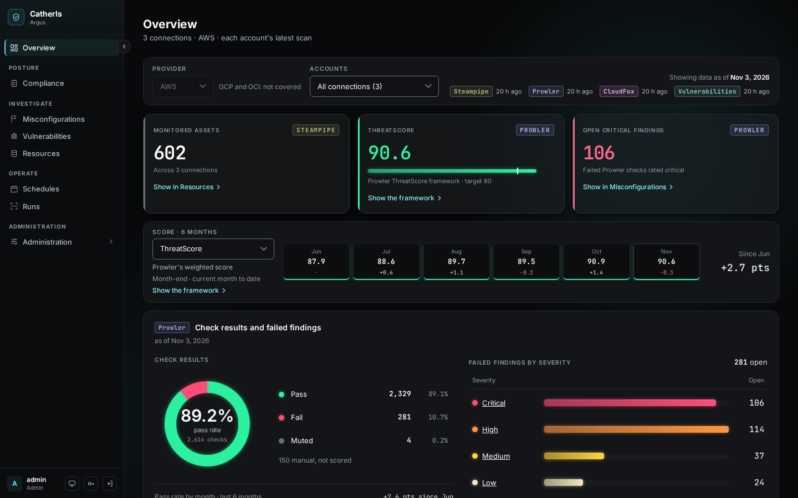
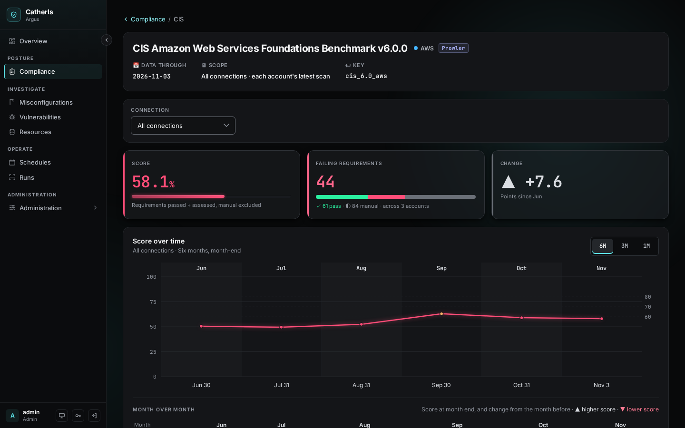
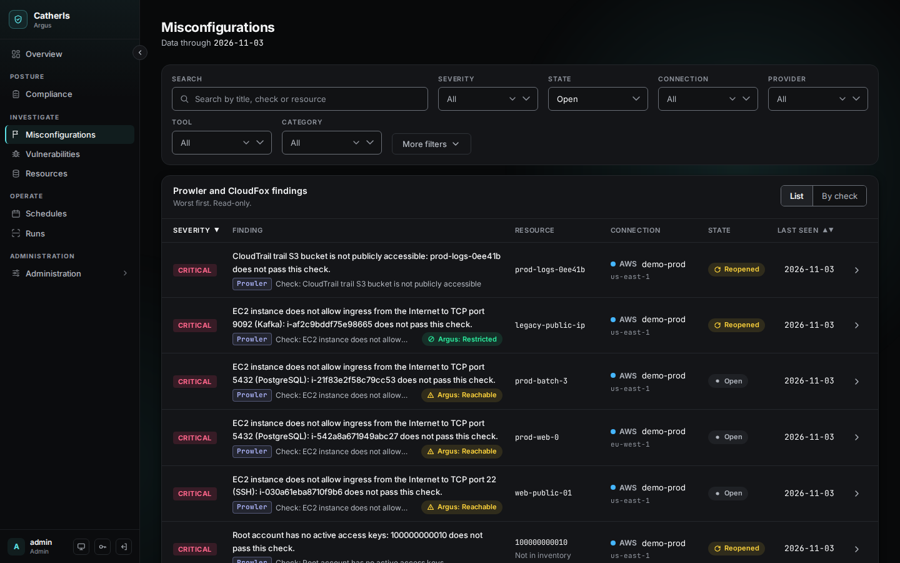
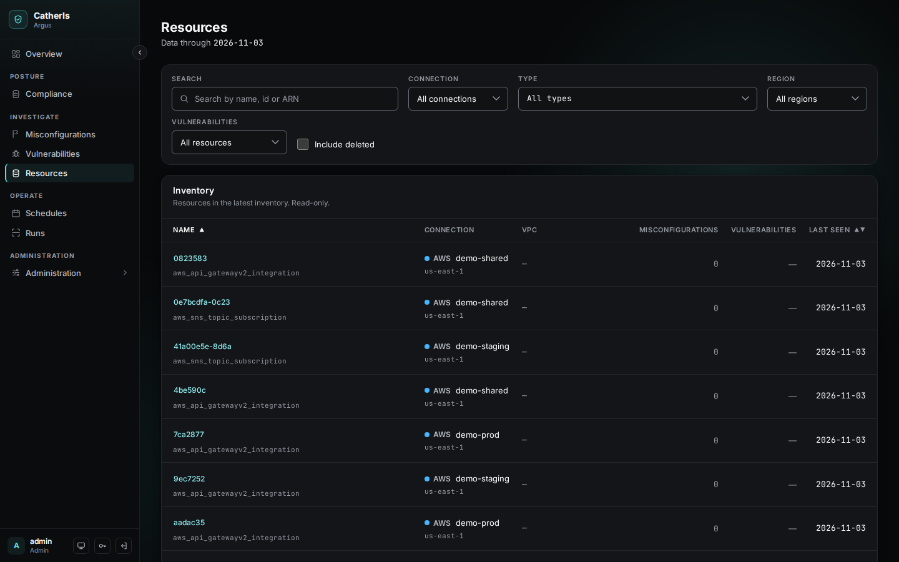
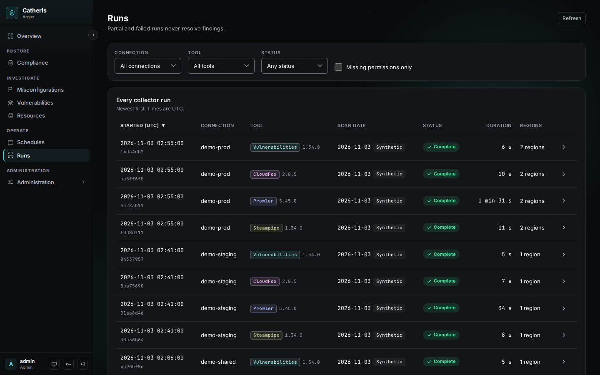

# Getting started

**Owner:** `documentation-writer` (document) · `cloud-native-platform-engineer` (commands)

Run Argus on your own machine with three Demo connections: synthetic AWS accounts, written in the
real output formats of Prowler, CloudFox and Steampipe, with six months of history. No cloud
account is needed and nothing leaves your machine. It takes about ten minutes, most of it the
first image build.

## Prerequisites

- Docker with Compose v2. Nothing else is installed on the host: every command below runs in a
  container, from the repository root.
- Port 8080 free on `127.0.0.1`. The UI is published on the loopback interface only.
- On Linux, if your user id is not 1000, prefix the commands with `UID=$(id -u) GID=$(id -g)`
  (Bash does not export `UID`).

## Start Argus

1. Create `.env` from the template. It is git-ignored; never commit it.

   ```bash
   cp .env.example .env
   ```

2. Choose the first admin's password. The command asks for it twice (at least 12 characters)
   and prints one line with its argon2id hash; paste that line into `.env`. The first start
   creates the admin `admin` from it; after you sign in, delete the line and add everyone else in
   **Administration → Users**.

   ```bash
   docker compose run --rm admin-tools hash-password
   ```

3. Create the key that encrypts stored credentials, and paste both printed lines into `.env`.

   ```bash
   docker compose run --rm admin-tools new-secret-key
   ```

4. Build and start. The `migrate` service creates the schema and exits; the others wait for it.

   ```bash
   docker compose up -d --build
   ```

5. Add the Demo connections, with 180 days of history each.

   ```bash
   docker compose run --rm seed --days 180
   ```

   The worker builds the history oldest day first: 1,620 runs, a few minutes. You can watch the
   queue drain under **Operate → Schedules**.

6. Open <http://localhost:8080> and sign in as `admin`.

If a step fails, [runbook.md, Troubleshooting](runbook.md#troubleshooting) lists the usual
causes. The same steps, with what to expect after each, are in
[runbook.md, First start](runbook.md#first-start).

## A tour

### Overview



The state of every connection on one page: monitored assets (Steampipe), the ThreatScore and its
trend (Prowler) and open critical findings (Prowler). Each number links to the list behind it. The tag on each card names the tool
that produced it, and the bar at the top says how old each tool's data is.

### Posture → Compliance



Every framework Prowler evaluates, with its pass rate. A framework page shows its requirements,
their results per account, and how each account moved month over month.

### Investigate → Misconfigurations, Vulnerabilities and Resources



**Misconfigurations** (named Findings until 2026-10-31) lists failing checks with severity, the resource, when it was first seen, and
whether it came back after being fixed (a regression). A finding opens to Prowler's own
explanation and the remediation steps and code. On Prowler's exposure checks it also shows
Argus's own verdict on whether the resource is really reachable from the internet, and why.
**Vulnerabilities** lists the CVEs each provider's own scanner reports (AWS Inspector on AWS), with
the vulnerable package, its fixed version, whether a public exploit exists and EPSS, as a list or
by CVE. **Resources** is the inventory. A resource opens to what each tool found on it, whether
it can be reached from the internet, what it connects to, and its configuration.



### Investigate → Map

Choose a resource and see what it connects to, as a diagram. The start lists the resource types in
your accounts with their counts; a type lists its resources, and a resource opens its map. You can
also search by name, id or ARN, or use **Open on Map** on any resource in **Resources**.

The **View** switch at the top right shows the same map two ways:

- **Infrastructure** (the default) shows what exists and how it connects. It shows no security
  finding and reads none, so it can be handed to an auditor or used as a network and architecture
  diagram.
- **Security** adds what is wrong on it (below). **Open on Map, Security view** on a resource in
  **Resources** opens it there directly.

Switching keeps the chosen resource, the depth, the kinds of line and the open panel, and the
chosen resource stays where it is on screen.

#### The diagram

The chosen resource sits in the middle, with what leads to it on its left and what it leads to on
its right, one column per hop. In each column a resource sits beside what it connects to; a very
tall column wraps into a few columns side by side so the map fills the screen. Subnets and VPCs are
ordinary resources: an EC2 instance, for example, opens with its subnet, its security groups and
its role one hop out. Each line says what it is in plain words ("routes to", "runs as", "in
network").

**Depth** draws one, two or three hops around the chosen resource at once. Open a resource and
choose **Expand** to add its own neighbours; **Collapse** takes them away again. The map never
walks past the internet, an account's administrator, another account's resource, a VPC or a
subnet on its own; expand those yourself.

The map opens fitted to the canvas when the cards stay readable, otherwise zoomed on the chosen
resource. A resource you choose near the edge moves to the centre. The zoom readout next to
**Fit** sets 100 %.

**Filters** chooses which kinds of line are drawn. A map opens with every kind but Data access,
which can reach many resources; **Select all** adds it and **Default** goes back. A solid line was
found by Argus's own rules, a dashed one only by CloudFox (the Legend says so too).

Choosing a resource opens its panel: a short summary first, then tabs. **Overview** says what it
is and where, **Connections** lists its lines by kind, and **Config** holds its tags and
configuration.

- More than 25 neighbours of one kind are drawn as one group card. Open it to list its members
  and add the ones you want.
- The map draws at most 500 resources. Past that it says so: lower the depth, show fewer kinds of
  connection, or Reset to start again from the chosen resource.
- A resource of another account is drawn but not expanded. Make it the focus to explore it in its
  own account.
- The map shows each account's latest scan and says which day that is.

#### The Security view

The same map, with what is wrong on it. It adds:

- **Security lines**, drawn heavier than the connections: is administrator, can escalate to,
  trusts an outside account, holds a credential, and CloudFox's "reaches" from the internet.
- **On each card**, a count of its open misconfigurations in the colour of the worst severity.
  A Critical or High one also gives the card a border in that colour, with the word on it.
- **Marks on each card:** a globe when Argus's rules confirm the internet can reach it, a bug for
  open vulnerabilities, and a warning sign for a public exploit. A card shows nothing when there
  is nothing, or when the tools have not scanned that account; its tooltip and the List view say
  which.
- **In the panel**, the summary is the resource's problems: open misconfigurations by severity,
  internet reach and vulnerabilities, each a link to the list that counts it. A **Problems** tab
  holds the tools' findings, its vulnerabilities, the door from the internet and CloudFox's
  commands.

The counts are the ones Resources and the lists show. The map draws the lines one by one, and
you follow them; whole routes are on **Attack paths**.

### Investigate → Map → Attack paths

The Map's second tab. After each ingested scan, Argus walks from every way in (a door the internet
reaches, a principal outside the scanned accounts, a leaked credential) through the lines its
rules and CloudFox found, and keeps each route that ends at something that matters: an administrator, a data store,
a secret in a workload's environment, a neighbour, or the exposure itself. The page reads what
was kept; nothing is worked out while you look.

- **One row per way in and kind of route**, titled "<kind>: <way in>", with its worst target and
  how many targets it has. Severity is the kind's; **Confidence** is how sure Argus is of its
  surest target (each target is as sure as its weakest step): Confirmed, Conditional (one assumption, such as a foothold), Potential (two or
  more, or a foothold with no evidence) or Not enough data. **Latent** routes, closed by one
  control today, are hidden until you ask for them.
- **Filters** (severity, kind, confidence, connection, routes that cross a connection, Open or
  Fixed) live in the URL, so a filtered list can be shared as a link.
- **A route's page** lists its worst targets (up to 25; the rest are counted) and the chosen
  target's steps, in order. Each step says how sure Argus is of it (Checked, Configured, Assumed,
  Missing data, Closed), and **Evidence and fix** says why, and which change breaks that link. A
  foothold ("Takes control of …") is its own step, with its evidence: a public exploit, IMDSv1,
  or none.
- When routes are behind the scans, or the last evaluation failed, the list says so; **Runs**
  also shows a failed evaluation, with its error.

A route is fixed only when every account it crosses was scanned completely, so a scan that timed
out never reads as a fix.

### Operate and Administration



**Schedules** runs the tools when you choose; **Runs** shows each run's status, duration, log and
the exact command. Under **Administration**, **Connections** adds accounts (a Demo connection
here, an AWS account later) and **Settings** holds every administration setting (an Operator sees
only Collection and throttling). Every change is written to the audit log.

## Next

- Scan a real account: [Connecting AWS accounts](connect-aws.md).
- Run Argus for a team, on one host: [runbook.md](runbook.md); or on Kubernetes:
  [runbook-kubernetes.md](runbook-kubernetes.md).
- Stop everything with `docker compose down`. The data stays in Docker volumes;
  `docker compose down -v` deletes it.
