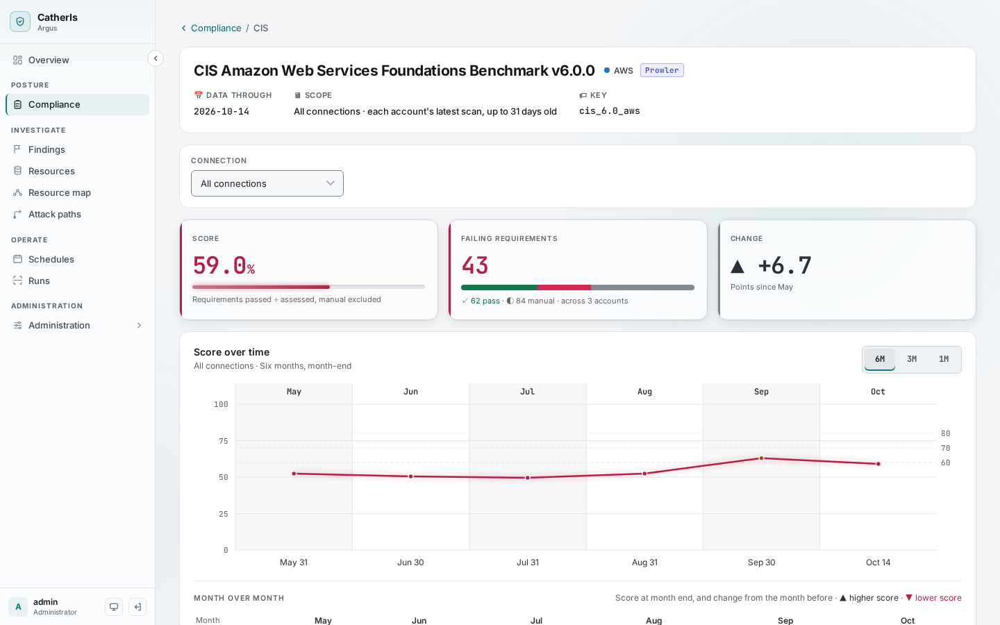
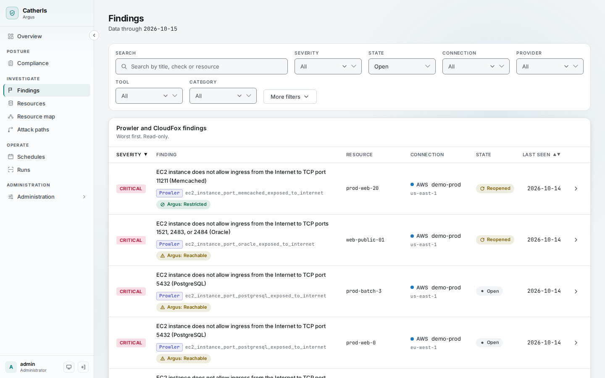
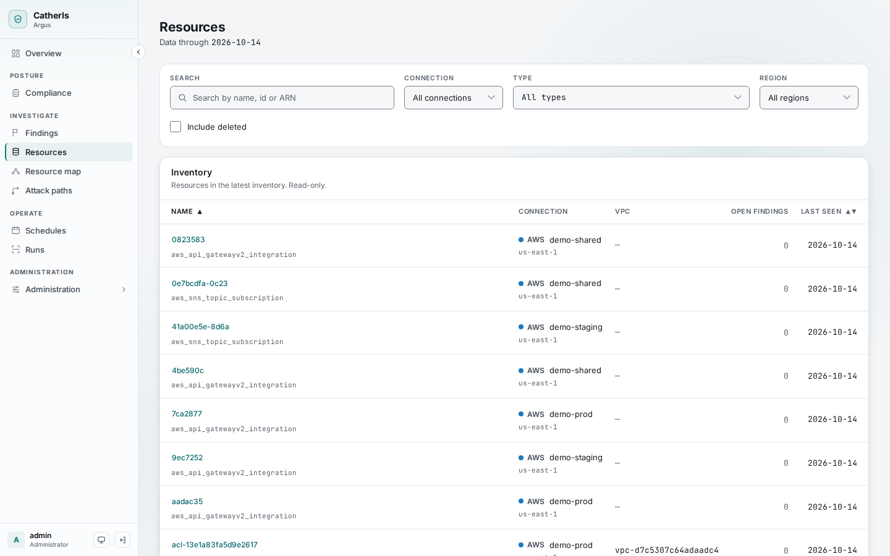
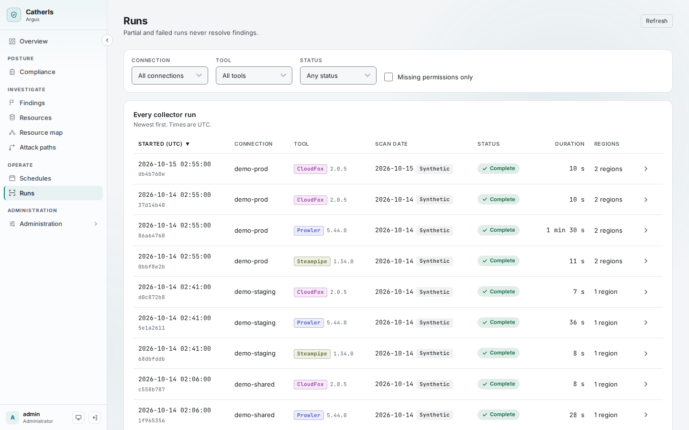

# Getting started

**Owner:** `documentation-writer` (document) · `cloud-native-platform-engineer` (commands)

Run Argus on your own machine with three Demo connections: synthetic AWS accounts, written in the
real output formats of Prowler, CloudFox and Steampipe, with six months of history. No cloud
account is needed and nothing leaves your machine. It takes about ten minutes, most of it the
first image build.

## Prerequisites

- Docker with Compose v2. Nothing else is installed on the host: every command below runs in a
  container, from the repository root.
- Port 8080 free on `127.0.0.1`. The UI is published on the loopback interface only.
- On Linux, if your user id is not 1000, prefix the commands with `UID=$(id -u) GID=$(id -g)`
  (Bash does not export `UID`).

## Start Argus

1. Create `.env` from the template. It is git-ignored; never commit it.

   ```bash
   cp .env.example .env
   ```

2. Choose the first admin's password. The command asks for it twice (at least 12 characters)
   and prints one line with its argon2id hash; paste that line into `.env`. The first start
   creates the admin `admin` from it; after you sign in, delete the line and add everyone else in
   **Administration → Users**.

   ```bash
   docker compose run --rm admin-tools hash-password
   ```

3. Create the key that encrypts stored credentials, and paste both printed lines into `.env`.

   ```bash
   docker compose run --rm admin-tools new-secret-key
   ```

4. Build and start. The `migrate` service creates the schema and exits; the others wait for it.

   ```bash
   docker compose up -d --build
   ```

5. Add the Demo connections, with 180 days of history each.

   ```bash
   docker compose run --rm seed --days 180
   ```

   The worker builds the history oldest day first: 1,620 runs, a few minutes. You can watch the
   queue drain under **Operate → Schedules**.

6. Open <http://localhost:8080> and sign in as `admin`.

If a step fails, [runbook.md, Troubleshooting](runbook.md#troubleshooting) lists the usual
causes. The same steps, with what to expect after each, are in
[runbook.md, First start](runbook.md#first-start).

## A tour

### Overview


The state of every connection on one page: monitored assets (Steampipe), the ThreatScore and its
trend (Prowler), open critical findings (Prowler) and exploitable attack paths (CloudFox and
Argus's own rules). Each number links to the list behind it. The tag on each card names the tool
that produced it, and the bar at the top says how old each tool's data is.

### Posture → Compliance



Every framework Prowler evaluates, with its pass rate. A framework page shows its requirements,
their results per account, and how each account moved month over month.

### Investigate → Misconfigurations, Vulnerabilities and Resources



**Misconfigurations** (named Findings until 2026-10-31) lists failing checks with severity, the resource, when it was first seen, and
whether it came back after being fixed (a regression). A finding opens to Prowler's own
explanation and the remediation steps and code. On Prowler's exposure checks it also shows
Argus's own verdict on whether the resource is really reachable from the internet, and why.
**Vulnerabilities** lists the CVEs each provider's own scanner reports (AWS Inspector on AWS), with
the vulnerable package, its fixed version, whether a public exploit exists and EPSS, as a list or
by CVE. **Resources** is the inventory, with each resource's configuration as of any past day.



### Investigate → Resource map


Starts from the **front doors**: every way traffic can arrive from the internet, judged from route
tables, security groups and network ACLs as Reachable, Restricted or Unknown. Opening one draws the
whole chain behind it, record by record and hop by hop, down to the roles and data it reaches.

### Investigate → Attack paths


Paths from a way in (an exposed port, a resource public by its own policy, an outside principal,
a leaked access key) to administrator or to data. Each row says how the path gets in, each step
names its move ("can escalate via iam:CreatePolicyVersion"), and each link carries its evidence
and the fix. A confidence per step says how sure Argus is.

### Operate and Administration



**Schedules** runs the tools when you choose; **Runs** shows each run's status, duration, log and
the exact command. Under **Administration**, **Connections** adds accounts (a Demo connection
here, an AWS account later) and **Settings** holds every administration setting. Every change is
written to the audit log.

## Next

- Scan a real account: [Connecting AWS accounts](connect-aws.md).
- Run Argus for a team, on one host: [runbook.md](runbook.md); or on Kubernetes:
  [runbook-kubernetes.md](runbook-kubernetes.md).
- Stop everything with `docker compose down`. The data stays in Docker volumes;
  `docker compose down -v` deletes it.
